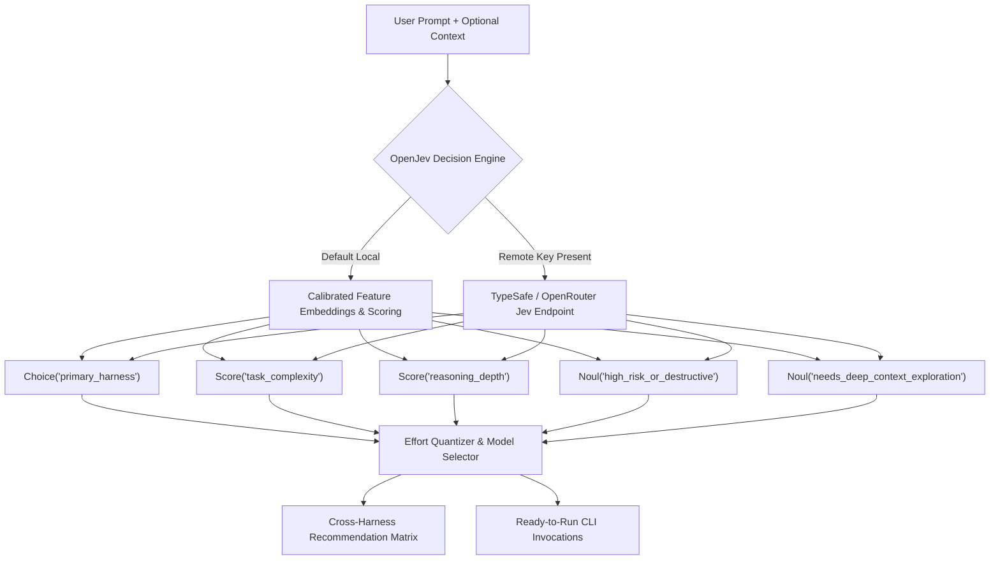

# OpenJev Effort & Coding Harness Router — Design Document

## 1. Executive Summary

As frontier coding agents and models proliferate, developer productivity and token economy hinge on the formula:
$$\text{Coding Agent} = \text{Model} + \text{Harness} + \text{Reasoning Effort}$$

Different tasks require drastically different reasoning budgets, harness capabilities, and model tiers. A minor syntax fix sent to Claude Opus 5.5 or OpenAI o1 with maximum thinking effort wastes seconds and dollars; conversely, an architectural overhaul or distributed consensus bug delegated to a lightweight model without reasoning tokens leads to hallucinations and broken implementations.

This project delivers **`effort-harness-router`**, a standardized, cross-agent routing skill powered by an open-source implementation of TypeSafe's **OpenJev System-1 Decision Architecture**. The router evaluates any coding prompt in milliseconds, outputting:
1. Recommended **Harness** (Claude Code, Antigravity, Codex, Grok, Oh My Pi, Pi, Cursor, Windsurf, Aider, Cline).
2. Recommended **Model** (Frontier/Next-Gen vs. Legacy/V4 generations).
3. Recommended **Reasoning Effort** (`none`, `low`, `medium`, `high`, `max`) with exact token budgets.
4. Exact, copy-pasteable CLI commands and configuration flags.

---

## 2. OpenJev System-1 Decision Contract

Unlike autoregressive generative models that stream tokens sequentially, **OpenJev** is a discriminative "System-1" decision engine. It evaluates prompts in a single forward pass without generating conversational prose, producing calibrated probabilistic outputs across three primitive types:

### 2.1 Jev Schema Primitives

1. **`Score("task_complexity")`**:
   - `trivial` (weight 0.1): Typos, formatting, single-line edits, simple CLI commands.
   - `routine` (weight 0.4): Standard functions, straightforward unit tests, CRUD endpoints, isolated bugfixes.
   - `complex` (weight 0.7): Multi-file refactors, concurrency, caching layers, state machine synchronization.
   - `frontier_architectural` (weight 1.0): Greenfield system design, distributed consensus, compiler passes, high-ambiguity specifications.

2. **`Score("reasoning_depth")`**:
   - Continuous score $R \in [0.0, 1.0]$ quantized into discrete thinking budgets:
     - $[0.00, 0.20) \to \textbf{none}$ ($0$ tokens)
     - $[0.20, 0.45) \to \textbf{low}$ ($1,024 - 2,048$ tokens)
     - $[0.45, 0.70) \to \textbf{medium}$ ($4,096 - 8,192$ tokens)
     - $[0.70, 0.90) \to \textbf{high}$ ($16,384 - 32,768$ tokens)
     - $[0.90, 1.00] \to \textbf{max}$ ($64,000+$ tokens)

3. **`Choice("primary_harness")`**:
   - Distribution across 10 supported coding harnesses:
     `antigravity`, `claude_code`, `codex`, `grok`, `oh_my_pi`, `pi`, `cursor`, `windsurf`, `aider`, `cline`.

4. **`Noul("high_risk_or_destructive")`**:
   - Calibrated binary probability $P(\text{destructive}) \in [0.0, 1.0]$ for operations modifying production databases, deleting files, or running unverified shell scripts.

5. **`Noul("needs_deep_context_exploration")`**:
   - Calibrated binary probability $P(\text{large\_context}) \in [0.0, 1.0]$ favoring harnesses with massive context windows (e.g. Antigravity with Gemini 3.8's 2M+ context) or whole-repo indexing.

---

## 3. Supported Harnesses & Dual-Generation Model Matrix

The router supports both **Frontier/Next-Gen** and **Legacy/V4** model profiles across all 10 harnesses:

| Coding Harness | Command / Tool | Lightweight / Fast (Low Effort) | Balanced / Flagship (Med Effort) | Frontier / Reasoning (High/Max Effort) | Legacy / V4 Equivalent |
| :--- | :--- | :--- | :--- | :--- | :--- |
| **Claude Code** | `claude` | `claude-haiku-5.5` | `claude-sonnet-5.5` | `claude-opus-5.5` | `claude-3-5-sonnet`, `claude-opus-4.5` |
| **Antigravity** | `agy` | `gemini-3.8-flash` | `gemini-3.8-flash` (high) | `gemini-4-argon` / `opus-5.5` | `gemini-1.5-pro`, `gemini-2.0-flash` |
| **OpenAI Codex** | `codex` | `gpt-5.4-mini` | `gpt-5.3-codex` | `gpt-5.5` (`--effort xhigh`) | `gpt-4o`, `o1`, `o3-mini` |
| **Grok Code** | `grok` | `grok-4-fast` | `grok-4` | `grok-4-heavy` | `grok-2`, `grok-3` |
| **Oh My Pi (OMP)** | `omp` | `qwen3-coder-next` | `deepseek-v4` | `deepseek-r1` / `deepseek-v4-pro` | `qwen-2.5-coder-32b`, `deepseek-v3` |
| **Pi** | `pi` | `qwen3-coder-7b` | `deepseek-v4-flash` | `deepseek-r1` | `qwen-2.5-coder-7b`, `claude-3-5-haiku` |
| **Cursor** | `cursor` | `claude-haiku-5.5` | `claude-sonnet-5.5` | `claude-opus-5.5` | `cursor-small`, `gpt-4o` |
| **Windsurf** | `windsurf` | `cascade-fast` | `cascade-base` | `cascade-deep` | `swe-bench-lite` |
| **Aider** | `aider` | `haiku-5.5` | `sonnet-5.5` | `opus-5.5` | `gpt-4o` |
| **Cline / Roo Code**| VS Code MCP | `gemini-3.8-flash` | `claude-sonnet-5.5` | `claude-opus-5.5` / `deepseek-r1` | `claude-3-5-sonnet` |

---

## 4. Cross-Agent Universal Skill Distribution

To ensure any coding harness can execute or be routed by this skill, files are organized and distributed universally:

1. **Antigravity Workspace**: `.agents/skills/effort-harness-router/SKILL.md`
2. **Antigravity Global**: `~/.gemini/config/skills/effort-harness-router/SKILL.md`
3. **OpenAI Codex**: `~/.codex/skills/effort-harness-router/SKILL.md`
4. **Claude Code**: `~/.claude/skills/effort-harness-router/SKILL.md`
5. **Oh My Pi**: `~/.omp/skills/effort-harness-router/SKILL.md`
6. **Pi**: `~/.pi/skills/effort-harness-router/SKILL.md`

Each skill file provides identical triggering criteria and instructions to call `python scripts/jev_router.py "<prompt>"`.

---

## 5. Verification & TDD Plan

The implementation will strictly follow Test-Driven Development:
1. **`test_jev_router.py`**:
   - Test 1: Trivial syntax & typo prompts $\to$ verify `effort: none`, `tier: fast`, low token budget.
   - Test 2: Standard feature & endpoint implementation $\to$ verify `effort: medium`, `tier: balanced`.
   - Test 3: Complex architectural & distributed algorithms $\to$ verify `effort: high|max`, `tier: frontier`.
   - Test 4: Harness affinity targeting (e.g., prompt mentioning terminal bash, git cherry-picks, or LSP debugging).
   - Test 5: Profile switching (`--profile frontier` vs `--profile legacy`).
   - Test 6: JSON mode output (`--json`) for automated agent programmatic piping.
